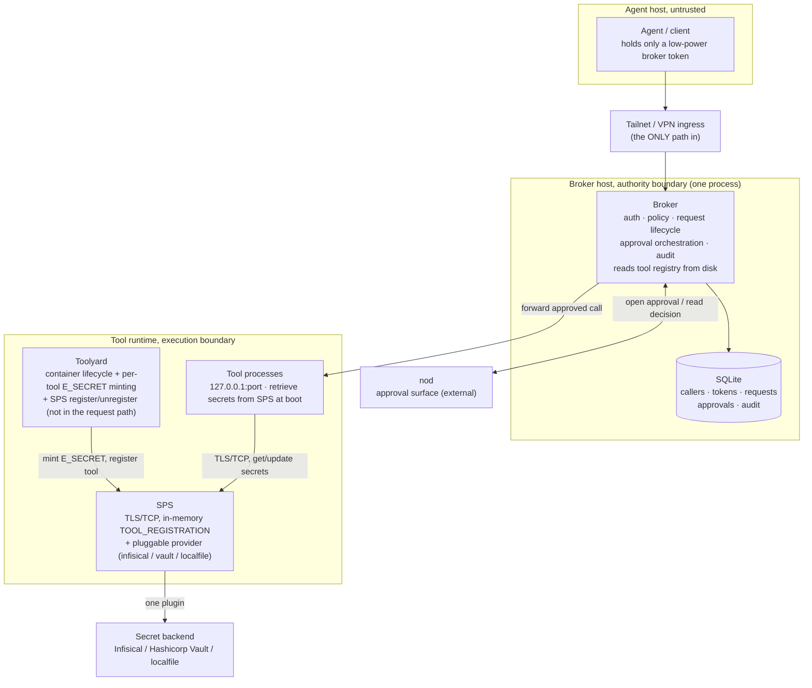
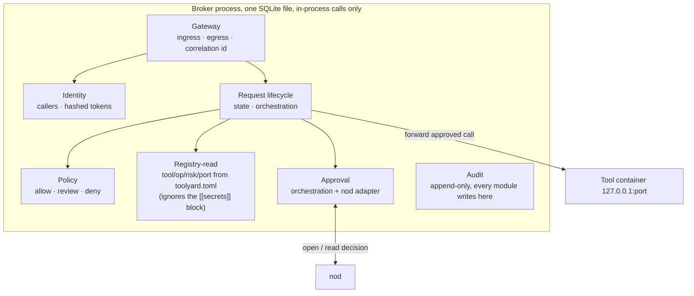

# Architecture

How the system works, and why. Read [PROJECT.md](../PROJECT.md) for the summary
and [plan.md](../plan.md) for the buildable, component-by-component plan.

**Direction:** the system is *collapsed to deployment reality*, a few processes
with trusted-host process seams, not enforced same-user isolation. The detailed
ownership rules live as **module seams inside the broker** (second diagram).

## Physical picture (the boundary is the architecture)

Typically the broker, toolyard, SPS, and tool containers all run on **one host**,
bound to `127.0.0.1`, not isolated from their shared OS account. The tailnet
is the only way in; nod and the secret backend are the only things reached out to.

The request path is broker → tool container **directly** on the tool's
loopback port; the broker reads the per-tool `X-Toolstack-Secret` channel
credential from dedicated `channels.json`, never E_SECRET/private-state fallback.
Channel and SPS credentials are independently random. Tools retrieve through SPS;
trusted same-account processes still have file/memory access. See
[current security contracts](security-contracts.md) and its pending release gates.

## Inside the broker (module seams)

These are modules in one process, not services. Each keeps the ownership rule it
had when it was a "service" (see the module table in [plan.md](../plan.md)). They
share one SQLite file and call each other in-process: **no network and no
inter-module auth**, which is exactly the cost the collapse removes. Every module
records to the Audit module.

## Trust boundaries

| From → To | Path | Auth |
|---|---|---|
| Agent → Broker | Tailscale Serve (tailnet-only) | Bearer token bound to one caller |
| Broker → Tool | localhost HTTP / JSON-RPC | Separate per-tool channel credential required by uplift; do not reuse SPS E_SECRET |
| Toolyard → SPS | TLS/TCP, one JSON line per direction | In-body `spsecret` (mode 0600 enforced on `/etc/toolstack/sps.env`); server cert verified against `SP_TLS_CA` |
| Tool → SPS | TLS/TCP, one JSON line per direction | In-body `esecret` (SPS capability, not broker channel credential); same CA verify |
| SPS → Backend | per-plugin | plugin handles its own credential |
| Broker → nod | HTTP over tailnet | nod issuer token (on the broker host) |
| nod → Broker (callback), *not implemented, not planned* | - | No callback route exists; resolution is poll-only. Rejected on security grounds: nod posts callbacks unauthenticated, so a receiver would let anyone forge an approval. |
| Operator → Broker | CLI on the host | Direct SQLite / `brokerctl` |
| Operator → SPS | `python3 -m sps.cli` on the host (init / vault-set / vault-get) | The `sps.env` mode + a service account on the host |

## What holds the line

The broker authorizes actions and SPS authorizes secret mappings. These design
roles do not prove secrets cannot reach the control plane: tool responses may
contain them, and same-user processes share host authority. Redaction and local
audit have limits. See [runtime matrix](runtime-matrix.md) for the release boundary.

## Why it's shaped this way

The agent can reach only the broker, over one tunnel. The broker decides. The tool
executes with its own secrets, which must be redacted from results if confidential.
Review-policy operations go to nod for a human. Release support requires a dedicated
Toolstack VM with trusted tools and external broker-only agents. Laptop/same-account
agents are development-only, not secret isolation. Local audit is not tamper-proof.
